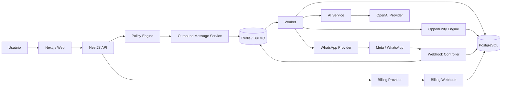

# SaaS Lead — Arquitetura do MVP

**Data:** 2026-09-29
**Status:** aprovada para planejamento em 2026-09-29
**Produto:** SaaS horizontal de inteligência comercial e recuperação de oportunidades pelo WhatsApp oficial

## 1. Objetivo e critérios de sucesso

O produto transforma conversas comerciais esquecidas em oportunidades acionáveis. O MVP será considerado validado quando uma empresa real conseguir:

1. criar uma conta e uma organização;
2. conectar oficialmente seu WhatsApp Business;
3. receber eventos suportados por webhook;
4. formar contatos, conversas e mensagens isolados por organização;
5. analisar uma conversa com IA estruturada;
6. detectar uma oportunidade por regras explícitas;
7. revisar uma sugestão de follow-up;
8. passar a mensagem pelo Policy Engine;
9. aprovar e enviar pela API oficial;
10. receber a resposta e atualizar o resultado.

O produto é horizontal. Segmentos como oficinas, clínicas ou imobiliárias usam o mesmo núcleo. Diferenças de segmento entram em configurações da organização, catálogo de serviços, regras comerciais, prompts versionados e landing pages, não em forks do domínio.

## 2. Escopo do MVP

### Incluído

- autenticação, organizações, membros e RBAC;
- onboarding e configurações comerciais;
- conexão oficial com a WhatsApp Business Platform;
- ingestão idempotente de webhooks;
- contatos, conversas e mensagens;
- processamento assíncrono;
- análise estruturada com IA;
- Opportunity Engine determinístico;
- sugestões de follow-up;
- Policy Engine obrigatório;
- aprovação humana antes do envio;
- acompanhamento de status e respostas;
- planos, assinatura e medição de uso;
- auditoria, observabilidade e controles básicos de LGPD;
- dashboard baseado em resultados comerciais verificáveis.

### Fora do MVP

- aplicativos móveis;
- CRM completo;
- automação comercial autônoma;
- campanhas em massa;
- integrações com dezenas de CRMs;
- voice AI, ligações e modelo próprio de ML;
- white-label, marketplace e afiliados;
- microsserviços e Kubernetes;
- atribuição de receita sem evidência confiável.

## 3. Decisões arquiteturais

### 3.1 Estilo

Será usado um **monólito modular com workers**, organizado em monorepo TypeScript. Essa abordagem reduz complexidade operacional para dois desenvolvedores e mantém fronteiras que permitem extração futura, se volume ou isolamento operacional justificarem.

### 3.2 Stack inicial

- Web: Next.js, React, TypeScript, Tailwind CSS e shadcn/ui.
- API: NestJS sobre Node.js.
- Worker: processo NestJS/Node.js separado, compartilhando módulos de aplicação.
- Banco: PostgreSQL.
- ORM: Prisma.
- Filas e cache: Redis e BullMQ.
- Contratos: Zod onde houver entrada externa ou saída de IA.
- IA: OpenAI via `AIProvider`, usando Responses API e Structured Outputs.
- WhatsApp: Meta WhatsApp Business Platform/Cloud API oficial.
- Billing: provider abstrato; Stripe é a primeira opção a validar.
- Pacotes: pnpm workspaces e Turborepo.
- Ambiente local: Docker Compose para PostgreSQL e Redis.

### 3.3 Princípios

- regras autorizam; IA apenas sugere e produz sinais;
- nenhum envio sai diretamente da IA;
- toda integração externa é idempotente e observável;
- todo acesso de negócio carrega contexto de organização;
- operações demoradas são assíncronas;
- dados e custos são minimizados por padrão;
- nenhuma funcionalidade tenta contornar regras do WhatsApp;
- receita e ROI somente são exibidos quando atribuíveis.

## 4. Diagrama de componentes



## 5. Estrutura planejada do monorepo

```text
apps/
  web/                 # interface e BFF apenas quando necessário
  api/                 # HTTP, auth, webhooks e casos de uso síncronos
  worker/              # consumidores BullMQ e tarefas agendadas
packages/
  database/            # Prisma client, schema e migrations
  contracts/           # DTOs, schemas Zod, enums e eventos
  config/              # configuração tipada e validação de ambiente
  observability/       # logs, tracing e correlação
  ai/                  # interfaces, schemas e providers de IA
  whatsapp/            # interfaces e provider Meta
  policy/              # regras puras de autorização de envio
  ui/                   # componentes compartilhados do frontend
docs/
  architecture/
  decisions/
  runbooks/
  superpowers/specs/
infra/
  docker/
prisma/                # opcional; preferir dentro de packages/database
```

Módulos de negócio permanecem em `apps/api/src/modules` enquanto forem usados apenas pela API. Somente código realmente compartilhado será promovido para `packages`, evitando um monorepo fragmentado artificialmente.

## 6. Módulos e limites

- **Auth:** identidade, sessão e recuperação de acesso.
- **Organizations:** organização, membros, convites, papéis e configurações.
- **WhatsApp:** contas, números, tokens protegidos, templates e provider.
- **Webhooks:** verificação, assinatura, envelope bruto e deduplicação.
- **Contacts:** identidade do contato dentro de uma organização.
- **Conversations:** estado comercial e resumo incremental.
- **Messages:** mensagens de entrada, saída e status.
- **AI Analysis:** orquestração de análise estruturada e controle de custo.
- **Opportunities:** regras, ciclo de vida, prioridade e eventos.
- **Policy:** decisão pura e auditável sobre possibilidade de envio.
- **Outbound:** aprovação, outbox, envio e reconciliação.
- **Subscriptions:** provider de billing, planos e entitlements.
- **Usage:** medidores de consumo e custo por organização.
- **Analytics:** métricas derivadas e atribuição verificável.
- **Audit:** ações sensíveis e mudanças de estado.

Módulos conversam por interfaces e eventos internos. Dependências devem apontar para contratos, nunca formar ciclos entre módulos.

## 7. Modelo inicial de dados

### Identidade e tenancy

- `User(id, email, name, status, createdAt, updatedAt)`
- `Organization(id, name, slug, status, timezone, locale, createdAt, updatedAt)`
- `OrganizationMember(id, organizationId, userId, role, status, createdAt)`
- `BusinessSettings(id, organizationId, industry, description, tone, businessHours, allowedClaims, discountPolicy, commercialPolicies, goals, version)`

### WhatsApp e conversas

- `WhatsAppAccount(id, organizationId, externalBusinessId, externalWabaId, status, encryptedCredentialRef, connectedAt)`
- `WhatsAppNumber(id, organizationId, whatsappAccountId, externalPhoneNumberId, displayNumber, status, qualityState)`
- `Contact(id, organizationId, externalWaId, name, phoneE164, metadata, createdAt, updatedAt)`
- `Conversation(id, organizationId, contactId, whatsappNumberId, state, summary, summaryVersion, lastInboundAt, lastOutboundAt, updatedAt)`
- `Message(id, organizationId, conversationId, externalMessageId, direction, type, contentRef, occurredAt, status, rawEventId)`
- `WebhookEvent(id, organizationId?, provider, externalEventKey, eventType, payloadRef, payloadHash, receivedAt, processedAt, status, attempts, errorCode)`

### IA e oportunidades

- `AIAnalysis(id, organizationId, conversationId, provider, model, promptVersion, inputHash, result, confidenceSignals, inputTokens, outputTokens, costEstimate, status, createdAt)`
- `AISuggestion(id, organizationId, opportunityId, analysisId, content, editedContent, status, createdAt)`
- `Opportunity(id, organizationId, contactId, conversationId, type, status, priority, estimatedValue, currency, reason, suggestedAction, detectionKey, detectedAt, closedAt)`
- `OpportunityEvent(id, organizationId, opportunityId, type, actorType, actorId, payload, occurredAt)`

### Envio, consentimento e templates

- `ConsentRecord(id, organizationId, contactId, channel, status, source, capturedAt, revokedAt)`
- `MessageTemplate(id, organizationId, externalTemplateId, name, category, language, status, components, syncedAt)`
- `OutboundMessage(id, organizationId, conversationId, opportunityId?, suggestionId?, idempotencyKey, policyDecisionId, status, content, templateId?, externalMessageId?, scheduledAt?, sentAt?)`
- `PolicyDecision(id, organizationId, outboundMessageId?, decision, reasons, policyVersion, contextSnapshot, createdAt)`

### Billing, uso e auditoria

- `Plan(id, code, name, status, entitlements, pricingConfig)`
- `Subscription(id, organizationId, planId, provider, externalCustomerId, externalSubscriptionId, status, trialEndsAt, currentPeriodEndsAt)`
- `UsageRecord(id, organizationId, metric, quantity, unitCost?, sourceType, sourceId, occurredAt)`
- `BillingEvent(id, provider, externalEventId, payloadRef, status, processedAt)`
- `AuditLog(id, organizationId, actorType, actorId, action, resourceType, resourceId, metadata, occurredAt)`

### Constraints essenciais

- unicidade de membro por `(organizationId, userId)`;
- contato único por `(organizationId, externalWaId)`;
- mensagem única por `(organizationId, externalMessageId)`;
- webhook único por `(provider, externalEventKey)`;
- oportunidade única por `(organizationId, detectionKey)`;
- envio único por `(organizationId, idempotencyKey)`;
- eventos de billing únicos por `(provider, externalEventId)`.

O payload bruto e conteúdo sensível poderão ser armazenados em referência criptografada ou storage dedicado, conforme a decisão de retenção. Não serão duplicados indiscriminadamente em logs.

## 8. Fluxo de entrada

```text
WhatsApp
→ Meta
→ GET de verificação ou POST assinado
→ validação de assinatura e tamanho
→ identificação segura do número/tenant
→ persistência do WebhookEvent e chave de deduplicação
→ resposta 2xx rápida
→ job normalize-inbound
→ upsert do contato e da conversa
→ inserção idempotente da mensagem
→ atualização de timestamps/estado resumido
→ regra decide se análise é necessária
→ job analyze-conversation
→ AIProvider retorna saída estruturada
→ validação Zod e persistência de AIAnalysis
→ Opportunity Engine aplica regras
→ criação/atualização idempotente de Opportunity
→ dashboard notificado por consulta/polling inicial
```

Falhas após o aceite do webhook são recuperadas por retry. Eventos definitivamente inválidos são marcados como rejeitados; falhas esgotadas vão para uma estratégia de dead letter com reprocessamento explícito.

## 9. Fluxo de envio

```text
Opportunity
→ geração de AISuggestion dentro das regras da empresa
→ usuário revisa, edita ou descarta
→ aprovação cria intenção de OutboundMessage
→ Policy Engine avalia contexto atual
→ BLOCKED registra razões e não publica envio
→ APPROVED grava PolicyDecision e publica send-message
→ worker revalida condições temporais críticas
→ WhatsAppProvider envia com idempotência local
→ externalMessageId e status são persistidos
→ webhooks atualizam sent/delivered/read/failed
→ resposta do contato atualiza conversa e oportunidade
→ resultado comercial é atribuído somente com evidência
```

Toda aprovação é vinculada ao conteúdo exato aprovado. Uma edição posterior exige nova decisão de política.

## 10. Multi-tenancy

- `organizationId` obrigatório em toda entidade de negócio.
- O tenant ativo é derivado da sessão e membership, nunca aceito sem validação a partir do body.
- Serviços e repositories recebem `TenantContext` explicitamente.
- Índices e constraints compostos incluem `organizationId` quando aplicável.
- Jobs carregam `organizationId`, mas o worker revalida a relação com o recurso.
- Cache keys, métricas, storage paths e logs são namespaced por organização.
- Testes de integração tentam acessar, atualizar e inferir dados entre dois tenants.
- PostgreSQL Row-Level Security será avaliado após estabilização do schema como defesa adicional, não como substituto da autorização da aplicação.

## 11. Autenticação e autorização

- Sessões seguras por cookie HTTP-only para o painel web.
- Senhas, se usadas, com algoritmo moderno e provider encapsulado; autenticação gerenciada pode ser escolhida na Fase 0.
- RBAC inicial: `OWNER`, `ADMIN`, `AGENT`.
- Autorização por ação e recurso, não apenas por rota.
- Operações sensíveis exigem auditoria: conexão WhatsApp, gestão de tokens, membros, políticas, billing, aprovações e envios.
- Tokens da Meta e providers nunca chegam ao navegador.
- Convites expiram e são de uso único.

## 12. Idempotência

Cada fronteira possui uma chave própria:

- webhook Meta: identificador externo estável; fallback documentado por hash canônico do envelope;
- mensagem: `organizationId + externalMessageId`;
- job: `eventType + resourceId + version`;
- oportunidade: regra + conversa + janela de detecção;
- envio: intenção imutável/UUID persistido antes da chamada externa;
- billing: `provider + externalEventId`;
- chamadas mutáveis ao provider: idempotency key quando suportada.

O padrão é **inbox + transactional outbox**. Banco e publicação não dependem de uma transação distribuída. Consumidores são at-least-once e, portanto, idempotentes.

## 13. Estratégia de filas

Filas iniciais:

- `webhook.normalize`
- `conversation.analyze`
- `opportunity.detect`
- `suggestion.generate`
- `message.send`
- `message.reconcile`
- `billing.process`
- `maintenance.retention`

Cada fila terá concorrência, timeout, backoff exponencial com jitter, máximo de tentativas e classificação de erros transitórios/permanentes. Jobs esgotados serão preservados para inspeção e reprocessamento seguro. Prioridades serão usadas somente onde gerarem valor comercial real.

## 14. Segurança, privacidade e LGPD

- TLS em trânsito e criptografia gerenciada em repouso.
- Secrets em secret manager no ambiente hospedado.
- Credenciais externas referenciadas e criptografadas, nunca logadas.
- Validação de assinatura, schema, tamanho e content type dos webhooks.
- Rate limiting em autenticação, endpoints públicos e ações de envio.
- Princípio de menor privilégio para banco, CI e providers.
- Logs estruturados sem conteúdo integral de conversa por padrão.
- Retenção configurada e jobs de exclusão verificável.
- Fluxos de exportação, correção e exclusão de titular.
- Backups criptografados e restauração testada.
- Mensagens de clientes tratadas como dados não confiáveis contra prompt injection.
- Instruções de sistema e regras empresariais separadas do conteúdo da conversa.
- Dependências verificadas e atualizadas de forma controlada.
- Revisão de segurança antes do beta externo e do lançamento comercial.

## 15. Estratégia de IA e economia de tokens

- regras tradicionais filtram quando a IA deve ser chamada;
- resumo incremental versionado substitui histórico integral;
- contexto inclui apenas mensagens recentes e fatos relevantes;
- classificação simples usa modelo econômico; ambiguidade pode escalar para modelo mais capaz;
- Structured Outputs com schema estrito e validação Zod;
- saída inclui sinais e evidências, não probabilidade inventada de fechamento;
- hash de entrada + versão de prompt permite cache seguro;
- modelo, tokens, latência e custo são registrados por organização;
- prompts têm versão, testes e dataset de avaliação;
- falha ou recusa da IA nunca autoriza ação externa;
- valores, descontos e promessas precisam existir nas configurações ou conversa.

## 16. Observabilidade

Todo fluxo propaga, quando aplicável:

- `request_id`
- `organization_id`
- `conversation_id`
- `webhook_event_id`
- `job_id`
- `outbound_message_id`

Métricas mínimas: taxa/latência de webhook, atraso e falhas das filas, retries, chamadas e custo de IA, oportunidades detectadas, decisões bloqueadas, envios e falhas da Meta. Alertas iniciais devem detectar webhook indisponível, backlog crescente, worker parado e falha repetida de envio.

## 17. Integrações externas

Obrigatórias:

- Meta Graph API / WhatsApp Business Platform;
- OpenAI API;
- provider de billing;
- e-mail transacional para autenticação e convites;
- storage de objetos, se adotado para payloads/conteúdo;
- observabilidade e monitoramento de erros.

Opcionais e não críticas:

- ViaCEP, BrasilAPI e IBGE para conveniência no onboarding;
- APIs públicas adicionais somente após avaliação de licença, disponibilidade, limites e qualidade.

Documentação oficial prevalece sobre repositórios agregadores. Falha em API pública opcional não bloqueia o fluxo central.

## 18. Variáveis de ambiente planejadas

```text
NODE_ENV
APP_URL
API_URL
DATABASE_URL
REDIS_URL
SESSION_SECRET
ENCRYPTION_KEY
LOG_LEVEL

META_APP_ID
META_APP_SECRET
META_VERIFY_TOKEN
META_GRAPH_API_VERSION
META_WEBHOOK_SECRET

OPENAI_API_KEY
OPENAI_ANALYSIS_MODEL
OPENAI_GENERATION_MODEL

BILLING_PROVIDER
STRIPE_SECRET_KEY
STRIPE_WEBHOOK_SECRET

EMAIL_PROVIDER
EMAIL_FROM
EMAIL_API_KEY

OBJECT_STORAGE_ENDPOINT
OBJECT_STORAGE_BUCKET
OBJECT_STORAGE_ACCESS_KEY
OBJECT_STORAGE_SECRET_KEY

SENTRY_DSN
OTEL_EXPORTER_OTLP_ENDPOINT
```

Nem todas existirão na Sprint 1. O pacote `config` rejeitará inicialização com variáveis obrigatórias ausentes e não imprimirá valores secretos.

## 19. Riscos técnicos e mitigação

| Risco | Impacto | Mitigação |
|---|---|---|
| Requisitos/limites da Meta mudarem | Alto | Fase 0 oficial, provider isolado, versão explícita da Graph API |
| Coexistência ou histórico não atenderem | Alto | Não depender de histórico; provar onboarding com conta real |
| Duplicação por retries | Alto | Inbox/outbox, constraints e consumidores idempotentes |
| Vazamento entre tenants | Crítico | TenantContext, constraints, testes negativos e auditoria |
| IA classificar ou sugerir incorretamente | Alto | regras, evidências, HITL, evals e Policy Engine |
| Custo de IA/mensageria crescer | Médio/alto | UsageRecord, resumo incremental, filtros e limites por plano |
| Bloqueio/queda de qualidade do número | Alto | monitorar status, bloquear envio e alertar organização |
| Atribuição falsa de receita | Alto | modelo explícito de conversão e estados “não atribuídos” |
| Complexidade horizontal excessiva | Médio | núcleo universal e configurações limitadas; sem builder genérico no MVP |
| Dependência de um provider | Médio | interfaces próprias sem abstração especulativa além do necessário |

## 20. Decisões a confirmar em fontes oficiais

Antes de fechar implementações dependentes de provider:

1. modalidade e requisitos atuais de Embedded Signup;
2. elegibilidade e obrigações como Tech Provider/Solution Partner;
3. disponibilidade, restrições e eventos da coexistência;
4. possibilidade e limites de sincronização de histórico;
5. verificação/assinatura e política de retries dos webhooks;
6. janela de atendimento, templates, categorias e consentimento;
7. pricing e limites de mensageria vigentes;
8. campos/status atuais para qualidade e conta;
9. versão suportada da Graph API e política de upgrade;
10. modelos OpenAI adequados, retenção e controles de dados;
11. billing provider, impostos, moeda e disponibilidade no Brasil/Canadá;
12. requisitos legais finais de LGPD com orientação especializada.

Cada conclusão relevante vira ADR com URL, data consultada e consequência arquitetural.

## 21. Roadmap de execução

### Sprint 0 — Discovery oficial e prova de risco

- matriz de decisões Meta/OpenAI/billing;
- conta/app de desenvolvimento e número de teste;
- prova isolada de webhook oficial e envio permitido;
- ADRs iniciais;
- modelo de ameaça e retenção preliminar.

### Sprint 1 — Fundação executável

- monorepo, aplicações e pacotes mínimos;
- PostgreSQL, Redis e Docker Compose;
- configuração tipada, lint, testes e CI;
- health/readiness endpoints;
- logging e correlação;
- primeiro schema Prisma e migration;
- documentação de setup.

### Sprint 2 — SaaS Core

- autenticação, Organization, Membership e RBAC;
- BusinessSettings horizontal;
- tenant context e testes de isolamento;
- auditoria básica.

### Sprint 3 — Conexão e webhooks Meta

- modelo de contas/números;
- onboarding oficial conforme decisão da Sprint 0;
- verificação e assinatura;
- inbox de webhook e deduplicação.

### Sprint 4 — Conversas assíncronas

- filas e worker;
- normalização de eventos;
- contatos, conversas, mensagens e status;
- retries e dead letter.

### Sprint 5 — IA estruturada

- AIProvider/OpenAIProvider;
- resumo incremental e análise estruturada;
- usage/custo de IA;
- dataset e evals iniciais.

### Sprint 6 — Opportunity Engine

- tipos universais iniciais;
- regras, prioridade e deduplicação;
- dashboard e detalhe da oportunidade.

### Sprint 7 — Sugestão, política e aprovação

- geração editável;
- Policy Engine versionado;
- aprovação/descarta;
- outbox e envio oficial;
- reconciliação de status e resposta.

### Sprint 8 — Billing e limites

- planos configuráveis;
- trial, assinatura, entitlements e webhooks;
- medição de uso e custo por organização.

### Sprint 9 — Analytics confiável

- métricas comerciais;
- definição e captura de conversão;
- receita recuperada somente quando atribuível.

### Sprint 10 — Beta e hardening

- onboarding acompanhado de 3–5 empresas de segmentos diversos;
- backup/restore, retenção e alertas;
- testes de carga e segurança;
- correções por dados reais;
- runbooks e preparação de produção.

## 22. Critérios de aceite da Sprint 1

1. Um novo desenvolvedor executa o ambiente seguindo o README sem conhecimento tácito.
2. `pnpm install`, migrations e execução local funcionam com comandos documentados.
3. Web, API e worker iniciam juntos pelo monorepo.
4. PostgreSQL e Redis sobem por Docker Compose com health checks.
5. API expõe health e readiness, distinguindo dependências indisponíveis.
6. Configuração falha cedo quando variável obrigatória está ausente.
7. Nenhum secret real está versionado; `.env.example` contém somente placeholders.
8. Lint, typecheck e testes rodam localmente e na CI.
9. Logs são estruturados e incluem `request_id` sem conteúdo sensível.
10. O schema inicial possui Organization e estrutura mínima de membership com migration reproduzível.
11. Há pelo menos um teste de integração com PostgreSQL e um teste de job com Redis.
12. README, CONTRIBUTING e arquitetura básica explicam comandos e convenções.
13. O deploy de um ambiente de desenvolvimento é documentado, ainda que não produtivo.

## 23. Primeira implementação após o plano

A primeira entrega será a **Sprint 0**, porque o maior risco não é React ou Prisma: é a viabilidade operacional da integração oficial. Ela produzirá documentação verificável e uma prova mínima isolada de webhook/envio usando recursos de teste da Meta. Em paralelo conceitual, a Sprint 1 será planejada, mas nenhuma arquitetura dependente de comportamento não confirmado da Meta será consolidada em código.

Depois da aprovação deste documento, será criado um plano de implementação detalhado, com tarefas pequenas, arquivos, testes, comandos de verificação e checkpoints de revisão.
